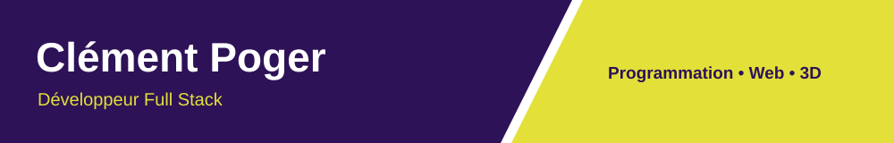

	

	
	

---

## À propos de moi

	

- **En ce moment :** je construis des projets et j'explore de nouvelles idées
- **J'apprends :** tout ce qui croise le web, le back-end et la 3D.
- **Mon petit plus :** j'aime créer une expérience visuelle et interactive, pas seulement des applications
- **Parlez-moi de :** projets, idées bizarres, et bugs qui n'ont aucun sens.

---

## Stack technique

**Langages**

	
	
	
	
	

**Web & Back-end**

	
	
	
	
	

**Outils & Création**

	
	
	
	
	

---

## Statistiques

	
	
	

---

## Projets à la une

| Projet | Description | Tech |
| --- | --- | --- |
| **[Tic Tac Toe ↗](https://github.com/Clement-Poger/bvn-tic-tac-toe)** | Un petit jeu pour découvrir le C | `C` `Shell` |
| **[Pokepedia ↗](https://github.com/Clement-Poger/pokepedia)** | Micro Projet autour de Pokemon | `API Calls` `JavaScript` `HTML/CSS` |
| **[Wordbook ↗](https://github.com/Clement-Poger/wordbook)** | Projet de Gestion de Compte & Données | `Supabase` `JavaScript` `HTML/CSS` |

## Quelques faits en vrac

- Carburant principal : théine et curiosité
- Le bug le plus long à résoudre était, évidemment, un point-virgule
- Quand je ne code pas, je modélise, je joue, je lis, je regarde des films et séries...
- Les meilleures idées arrivent toujours à 23h.

## Contact

	
	
	

	

